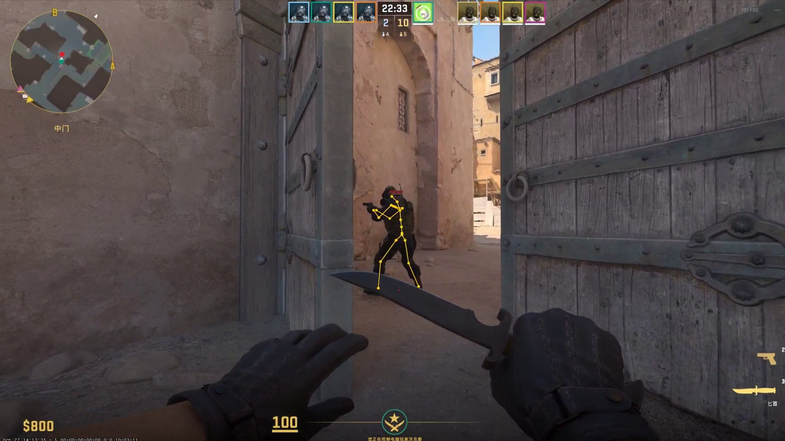

# CS2 Cheater

*External CS2 tools and libraries*

English | [中文](README.zh-CN.md)

---

## Projects

This repository brings together project overviews, previews, and source links. **cs2-external-traceline** is the first project added to the collection. Each project maintains its source and build configuration in its own repository.

| Project | Features | Platform |
|:--------|:---------|:---------|
| [cs2-external-traceline](https://github.com/ZhFuGui/cs2-external-traceline) | External ray queries / Cover checks / Penetration damage prediction | Windows x64 |

---

## cs2-external-traceline

**External Ray Queries · Cover Checks · Penetration Damage Prediction**

Queries A → B segments outside the game process using map collision geometry and a BVH acceleration structure. Supplies occlusion, collision hits, traversal thickness, and damage predictions to other tools.

| Capability | Description |
|:-----------|:------------|
| Cover checks | Detect scene occlusion between two points; return the closest hit or all hits |
| Traversal thickness | Return entry/exit intervals and path thickness where the geometry supports reliable volume queries |
| Damage prediction | Use weapon and material parameters for range falloff and penetration loss, with target hit-group and armor calculations |
| Scene caching | Import physics text or triangle data; build, save, and load collision scene caches |
| Integration | C API and C++ wrapper, with concurrent read-only queries on the same scene |

The library handles queries and calculations. The caller supplies scenes, weapon/material parameters, and target state; the consuming application draws skeletons, names, and other visuals. Damage predictions use the supplied static scene and parameters; full live-fire validation is still pending.

### Preview

 
Figure 1: Cover detection · Click the cover to watch in 1080p / 30 FPS

  

**Build environment:** Visual Studio 2022 · MSVC v143 · Windows SDK · C++20. Builds an x64 DLL; see the [public headers](https://github.com/ZhFuGui/cs2-external-traceline/tree/main/include/cs2-external-traceline) and [Visual Studio solution](https://github.com/ZhFuGui/cs2-external-traceline/blob/main/cs2-external-traceline.sln) in the project repository.

---

#### Disclaimer

This repository is for educational and research purposes only. 
Users assume all responsibility for any consequences arising from its use.

 

License · MIT &nbsp;|&nbsp; Maintained by [ZhFuGui](https://github.com/ZhFuGui)

