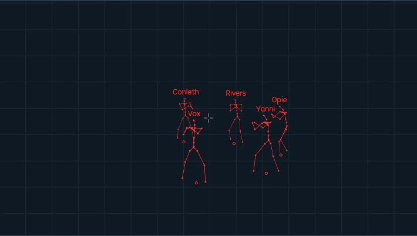

# CS2 Cheater

*CS2 外部工具与基础库*

[English](README.md) | 中文

---

## 项目概览

本仓库汇总各独立项目的功能、效果展示和源码入口。首个正式接入项目为 **cs2-external-traceline**；源码与构建配置在对应仓库维护。

| 项目 | 功能 | 平台 |
|:-----|:-----|:-----|
| [cs2-external-traceline](https://github.com/ZhFuGui/cs2-external-traceline) | 外部射线查询 / 掩体判断 / 穿透伤害预测 | Windows x64 |

---

## cs2-external-traceline

**外部射线查询 · 掩体判断 · 穿透伤害预测**

基于地图碰撞几何与 BVH 加速结构，在游戏进程外完成 A → B 线段查询。为上层工具提供遮挡状态、碰撞命中、穿越厚度及伤害预测结果。

| 能力 | 说明 |
|:-----|:-----|
| 掩体判断 | 判断两点之间是否被场景几何遮挡，查询最近命中或全部命中 |
| 穿越厚度 | 对支持可靠厚度计算的几何，返回穿入、穿出区间及路径厚度 |
| 伤害预测 | 结合武器与材质参数计算距离衰减、穿透损耗，并支持目标部位与护甲结算 |
| 场景缓存 | 导入物理文本或三角形数据，构建、保存及加载碰撞场景缓存 |
| 集成接口 | 提供 C API 与 C++ 包装，支持同一场景的并发只读查询 |

库本身负责查询与计算；场景、武器材质参数及目标状态由调用方提供。骨骼、名称等绘制由上层可视化程序实现。伤害预测基于所提供的静态场景与参数，尚未完成完整实机射击对照。

### 效果展示

  

**开发环境：** Visual Studio 2022 · MSVC v143 · Windows SDK · C++20。构建产物为 x64 DLL；[公开接口](https://github.com/ZhFuGui/cs2-external-traceline/tree/main/include/cs2-external-traceline)与[解决方案](https://github.com/ZhFuGui/cs2-external-traceline/blob/main/cs2-external-traceline.sln)见项目仓库。

---

#### 免责声明

本仓库仅用于学习交流。 
使用者需自行承担因此产生的一切后果。

 

License · MIT &nbsp;|&nbsp; Maintained by [ZhFuGui](https://github.com/ZhFuGui)

